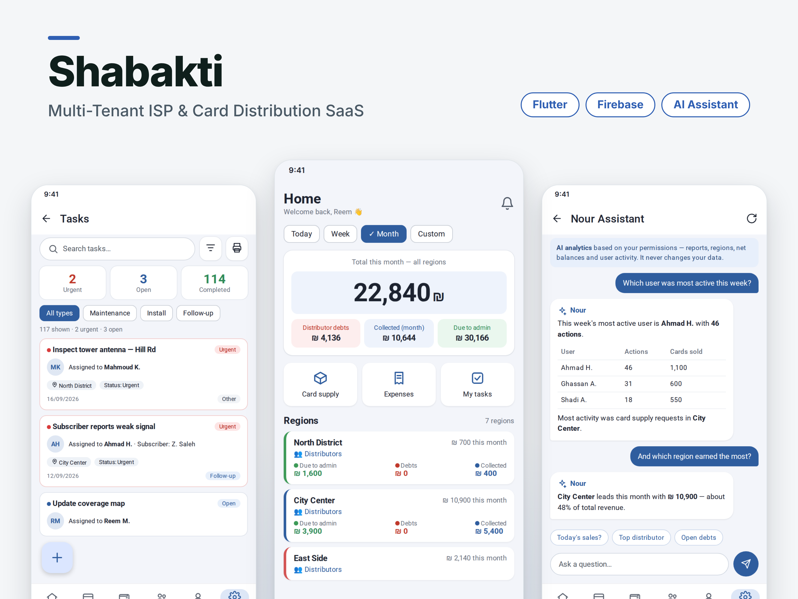
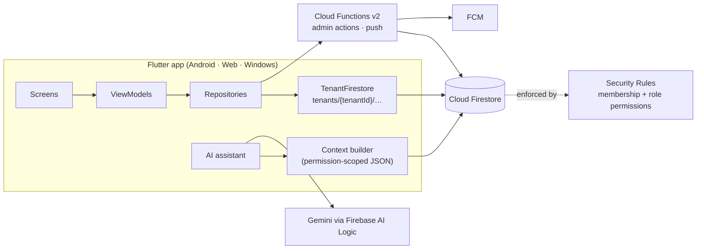

# Shabakti — Multi-Tenant SaaS for Internet Network Owners

A SaaS platform for owners of local internet networks who sell prepaid access cards through distributors. One app covers distributors, card batches and payments, stock requests, field tasks, inventory, expenses and salaries, with an AI assistant that answers questions about the business. Each network's data is fully isolated from every other network.

It started as **MyNour**, a single-network app built for one client in native Android (Java). I then rebuilt it in Flutter and turned it into a multi-tenant product: any network owner can sign up, create their network and add their own staff.

> **Full source code is private (commercial product) — available for review on request.**
> This repository contains the documentation and selected code samples in [`samples/`](samples/).

*Screens captured from a demo network with fake data.*

## Key features

- **Self-service onboarding** — a new owner signs up and creates their network (tenant) in one step, then adds staff and roles.
- **Distributors & card batches** — assign card batches to distributors, track debts and payments, confirm or reject batches, per-batch price overrides and discounts.
- **Card stock requests** — staff request card stock; admins review, approve or reject, with notifications at each step.
- **Areas** — every user works in one area, several areas or all areas; lists, totals and reports follow that scope.
- **Field tasks** — maintenance, install and follow-up tasks with assignees, status, priorities and responses.
- **Inventory** — devices and equipment with barcode scanning, movements between users, and a catalog of types and models.
- **Finance** — expenses, salaries, admin balances, and period reports (week / month / custom) per area.
- **Reports & exports** — branded PDF reports and Excel exports for inventory, tasks and periods.
- **Roles & permissions** — custom roles built from **97 permission codes in 19 groups**, enforced in Firestore Security Rules and Cloud Functions.
- **AI assistant** — ask "which region earned the most this month?" and get an answer from your own data, limited to what your role can see.
- **Push notifications** — FCM on mobile and web, with invalid tokens pruned automatically.
- **Activity log & presence** — audit trail of actions, and who is active in the app right now.
- **Admin preview** — an admin can preview the app exactly as a given user sees it.
- **RADIUS integration** — connects to the network's ADV Radius admin API.
- **In-app updates** — a small Node.js update server serves the latest Android/Windows build from GitHub Releases.

## Tech stack

| Layer | Technologies |
|---|---|
| Client | Flutter (Android, Web, Windows), Riverpod, `pdf` / `printing`, `excel`, `mobile_scanner` |
| Backend | Firebase Auth, Cloud Firestore, Firestore Security Rules, Cloud Functions v2 (Node.js), Firebase Cloud Messaging |
| AI | Gemini via Firebase AI Logic (`firebase_ai`) |
| Other | Node.js update server (GitHub Releases), ADV Radius HTTP API |
| Earlier version | Native Android (Java) — single-tenant MyNour |

## Architecture

The client is organised as **screens → view models → repositories**. Repositories never build Firestore paths by hand; they go through `TenantFirestore`, which only knows how to reach data under the active tenant.

## Engineering highlights

### 1. Tenant isolation enforced by the database, not just the app

**Problem:** many networks share one Firebase project. A bug or a modified client must never be able to read another network's data.

**Decision:**
- All business data lives under `tenants/{tenantId}/…` (about 30 collections).
- A top-level `user_tenant_index/{uid}` document maps each user to exactly one tenant.
- Security Rules check that index on every request (`isMember(tenantId)`), so the server decides which tenant a user belongs to. The client cannot choose a different one.
- On the client, `TenantContext` holds the active tenant and `TenantFirestore` is the only way to reach tenant data.

**Result:** even a tampered client is limited to its own network by the rules themselves.

**Public sample:** [`samples/01-tenant-isolation/`](samples/01-tenant-isolation/)

### 2. Fine-grained permissions in three places that agree

**Problem:** 97 permissions across many screens, and the same checks must hold in the app, in the rules and in server functions.

**Decision:**
- Roles store their permissions as a list (or a map of flags, for older data). `RoleModel` accepts both.
- Security Rules load the caller's role and check `hasPerm("…")` per collection and operation.
- Cloud Functions re-check permissions server-side (`assertPermission`) and refuse to act on a user from another tenant. For example, `adminSetUserPassword` requires `USERS_SET_PASSWORD` and writes an audit log entry.
- `AreaScope` adds a second dimension: one area, several areas, or `SCOPE_ALL`.

**Result:** hiding a button in the UI is only cosmetic. The data itself is protected by rules and functions.

**Public sample:** [`samples/02-permissions/`](samples/02-permissions/)

### 3. An AI assistant that only sees what the user is allowed to see

**Problem:** an assistant that reads the whole database would leak salaries, debts or other areas to staff who shouldn't see them.

**Decision:**
- The app builds a compact JSON context **on the device**, using the user's own Firestore permissions and area scope. Each section (tasks, stock, period reports, presence, expenses, salaries…) is added only if the matching permission is present.
- Admins get a richer system prompt with rules for computing net per area. Other users get a restricted one.
- The prompt tells the model to answer only from that JSON and never pretend to change data.
- Calls go through Firebase AI Logic with a fallback across several Gemini models.

**Result:** the assistant is useful for owners and safe to give to staff.

**Public sample:** [`samples/03-ai-assistant/`](samples/03-ai-assistant/)

### 4. Keeping Firestore costs predictable

**Problem:** list screens and dashboards can quietly burn through reads as data grows.

**Decision:**
- Every list query has an explicit limit (`FirestoreLimits`).
- Slow-changing data (areas, sections, roles) goes through a small TTL cache.
- Dashboards read pre-computed summary documents (`area_summaries`, `distributor_summaries`) instead of scanning raw records.

**Result:** read counts stay bounded as networks grow.

**Public sample:** [`samples/04-read-cost-control/`](samples/04-read-cost-control/)

## Security

- **Authentication:** Firebase Auth (email/password). Admin password changes go through a Cloud Function that checks permission and tenant membership.
- **Authorization:** role-based, with 97 permission codes checked in Security Rules and Cloud Functions (see highlight 2).
- **Tenant isolation:** server-side membership via `user_tenant_index` (see highlight 1).
- **Self-presence writes:** users can update only their own presence fields (`appOpen`, `lastActiveAt`, `lastActivePlatform`). Rules enforce this with `hasOnly`.
- **Secrets:** no service-account keys, `google-services.json` or environment files are committed. The update server ships with `.env.example` only.

## Source code & samples

Full source code is private (commercial product) — available for review on request.

| Sample | What it demonstrates |
|---|---|
| [`01-tenant-isolation`](samples/01-tenant-isolation/) | Tenant-scoped paths on the client and membership checks in Security Rules |
| [`02-permissions`](samples/02-permissions/) | Roles, area scope, and server-side permission checks in Cloud Functions |
| [`03-ai-assistant`](samples/03-ai-assistant/) | Permission-scoped context and Gemini calls with model fallback |
| [`04-read-cost-control`](samples/04-read-cost-control/) | Query limits and a TTL cache to keep Firestore reads bounded |

Samples are copied verbatim from the private repository with an English header added. Some inline comments and prompts are in Arabic, because the product is Arabic-first.

## My role

Designed, built, deployed and maintained end-to-end by Reem Mansour: the original Android app, the Flutter rebuild, the multi-tenant migration, Security Rules, Cloud Functions, the AI assistant and the update server.

## Author

**Reem Mansour**

- Website: https://rovira.dev
- LinkedIn: https://linkedin.com/in/reem-mansour-a76938247

© Reem Mansour. All rights reserved.
